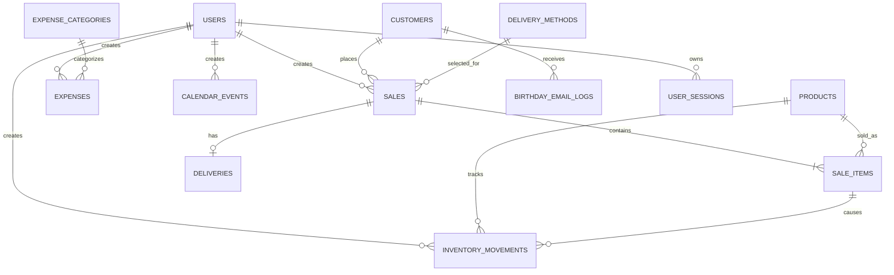

# Especificacao de arquitetura e migracao

**Status:** arquitetura aprovada e em implementacao incremental; autenticacao, clientes, produtos, estoque, vendas, acompanhamento de entregas, financeiro e painel foram integrados. O calendario esta em implementacao; administracao ainda aguarda migracao.
**Sistema legado analisado:** SY-Final, aplicacao Java Swing com persistencia em arquivos TXT.  
**Escopo de dados:** os registros dos arquivos TXT sao dados de teste e nao serao importados. As configuracoes visuais e de e-mail serao tratadas separadamente; credenciais nao serao copiadas para o codigo, banco ou GitHub.

## 1. Arquitetura alvo

Um unico repositorio GitHub, com frontend e backend em diretorios separados e projetos Vercel independentes:

```text
repositorio/
  frontend/   React + TypeScript + Vite -> projeto Vercel do frontend
  backend/    Python + FastAPI           -> projeto Vercel da API
  docs/       especificacoes e decisoes
```

O PostgreSQL sera gerenciado pelo Supabase. O unico projeto mantido e `projectyasar`, em East US / North Virginia (`us-east-1`), escolhido pela opcao geral Americas exibida no painel; a criacao de um segundo projeto foi cancelada e nenhum schema ou dado foi criado. Embora a documentacao liste Sao Paulo (`sa-east-1`) como regiao especifica, essa opcao nao apareceu no fluxo de criacao observado. Se o banco permanecer em Virginia, `iad1` e a candidata para a API Vercel, reduzindo latencia entre API e banco; considerar a latencia para usuarios no Brasil. Usuarios principais estao no Brasil. O plano atual do Supabase nao oferece backups gerenciados: o desenvolvimento pode prosseguir com dados ficticios, mas dados reais nao devem ser usados em producao antes de definir, automatizar e testar uma estrategia de backup/restauracao externa ou mudar de plano. A autenticacao sera propria do FastAPI; o Supabase sera usado como banco PostgreSQL, nao como provedor de identidade. As migracoes serao versionadas com Alembic. O frontend chamara a API HTTPS; a API usara uma lista explicita de origens CORS autorizadas. Variaveis de ambiente e credenciais SMTP existirao somente no ambiente do backend.

Vercel Functions suporta aplicacoes ASGI como FastAPI. O banco, o armazenamento persistente de imagens e o envio de e-mail continuam sendo servicos separados. A API deve usar conexoes PostgreSQL compatíveis com o modelo serverless e a regiao do banco deve ser escolhida considerando a regiao das funcoes.

O repositorio GitHub `projectyasar` e privado. A tentativa de configurar branch protection foi recusada pelo GitHub no plano atual; a resposta indicou GitHub Pro ou repositorio publico. A visibilidade nao sera alterada sem autorizacao. Ate uma decisao sobre o plano, o fluxo sera operacional: branches de tarefa, PRs para `main`, revisao manual e sem commits diretos em `main`.

## 2. Diagrama de entidades



## 3. Tabelas e regras de persistencia

Os nomes abaixo sao conceituais; a convencao final de nomes e tipos sera aplicada nas migracoes.

| Tabela | Campos e regras principais |
|---|---|
| `users` | `id`, nome completo, e-mail normalizado e unico, hash de senha, perfil (`admin`/`user`), estado (`active`/`inactive`), datas de criacao e alteracao. O hash nunca e retornado pela API. |
| `user_sessions` | Sessoes revogaveis vinculadas ao usuario; excluir/desativar a conta revoga suas sessoes. |
| `customers` | Nome, e-mail, telefone, endereco, `birthday_day`, `birthday_month`, `archived_at` e autoria opcional. Dia e mes sao ambos nulos ou ambos validos; 29/02 e permitido. |
| `products` | Nome, preco atual (`NUMERIC`), referencia de imagem externa, estado/arquivamento e autoria opcional. Imagens nao serao armazenadas no filesystem efemero das funcoes. |
| `delivery_methods` | Opcoes configuraveis de entrega, incluindo as existentes como dados iniciais de configuracao quando aprovadas. |
| `sales` | Cliente, data/hora, estado, forma de entrega e snapshots do nome/endereco relevantes ao historico. Vendas confirmadas nao sao apagadas para corrigir o estoque. |
| `sale_items` | Venda, produto, quantidade positiva, preco unitario aplicado (`NUMERIC`) e total calculado. O preco praticado fica preservado mesmo quando o preco atual do produto muda. |
| `inventory_movements` | Produto, data, tipo (`in`, `out`, `reversal`), quantidade positiva, origem e autoria opcional. Saidas manuais podem deixar o saldo negativo, que deve ser sinalizado. Correcoes sao novos movimentos imutaveis de reversao com motivo; saidas de venda sao corrigidas pelo fluxo de cancelamento. |
| `deliveries` | Uma entrega por venda, inclusive retirada/entrega pessoal; status (`pending`, `out_for_delivery`, `delivered`, `cancelled`), codigo de rastreio opcional e snapshot do endereco. Cancelar entrega nao cancela a venda automaticamente. Cancelar venda cancela entrega pendente na mesma transacao e e bloqueado apos despacho/conclusao. |
| `expense_categories` | Categorias configuraveis de lancamentos financeiros. |
| `expenses` | Data, categoria e valor positivo (`NUMERIC`), snapshot do nome da categoria, estado, motivo/data/autoria opcional do cancelamento e autoria de criacao. Despesas sao canceladas com justificativa e permanecem no historico. |
| `calendar_events` | Eventos manuais com data, descricao, tipo e autoria opcional. Aniversarios nao sao copiados para esta tabela. |
| `birthday_email_logs` | Cliente, ano celebrado, data/hora de tentativa, status, quantidade de tentativas e erro sanitizado. Restricao unica por cliente/ano torna o envio idempotente. |

### Integridade e exclusoes

- Chaves estrangeiras protegem relacionamentos. Valores monetarios usam `NUMERIC`, datas de negocio usam `DATE`/`TIMESTAMPTZ` e quantidades sao inteiros positivos.
- Clientes autenticados podem ser pesquisados, criados, editados, arquivados e restaurados. A API pagina resultados e por padrao omite arquivados; a interface apresenta o aniversario como dia/mes, mantendo 29/02 valido sem ano de nascimento.
- Produtos autenticados podem ser pesquisados, criados, editados, arquivados e restaurados; preco atual e `NUMERIC(12,2)` e imagem e uma referencia HTTP/HTTPS externa. Produtos referenciados por vendas nao podem ser excluidos; vendas preservam snapshots e precos aplicados.
- O saldo de estoque e calculado pelos movimentos (`entradas - saidas`). Saidas manuais podem deixar o saldo negativo, preservando o comportamento do sistema Java; a interface deve sinalizar esse saldo sem bloquear o lancamento.
- Movimentos manuais sao auditaveis e imutaveis. Corrigir um movimento manual cria uma reversao vinculada, com motivo obrigatorio, sem editar ou apagar o original; um movimento so pode ser revertido uma vez. Produtos arquivados nao aceitam novos movimentos, mas seus movimentos anteriores continuam consultaveis e podem ser revertidos.
- Criar uma venda com ate 50 itens e as respectivas saidas de estoque ocorre na mesma transacao. Estoque disponivel e calculado pelos movimentos; a venda e bloqueada se algum item nao tiver saldo suficiente.
- Cancelar uma venda exige motivo, registra estado de cancelamento e movimentos compensatorios; nao apaga a venda nem os movimentos originais. Movimentos originados por vendas nao podem ser revertidos pelo fluxo manual. O resumo por produto considera somente vendas concluidas.
- Toda venda tem uma entrega, criada como `pending` na mesma transacao. Status podem ser alterados diretamente entre os valores permitidos, como no legado; entrega cancelada nao cancela a venda, mas venda cancelada nao permite reabrir sua entrega.
- Despesas exigem valor maior que zero com no maximo duas casas decimais e categoria existente; categorias nao se repetem sem diferenciar maiusculas/minusculas. Cancelar uma despesa exige motivo, preserva o registro e impede um segundo cancelamento. O resumo financeiro inclui somente vendas concluidas e despesas ainda registradas.
- O painel retorna os 12 meses ate o mes atual, inclusive periodos sem dados; mostra quantidades de entrada/saida de estoque (incluindo os efeitos de reversoes), unidades vendidas em vendas concluidas e despesas nao canceladas. O saldo agregado atual considera produtos ativos e pode ser negativo.
- Cliente ou produto sem historico pode ser excluido. Com historico, deve ser arquivado e permanecer referenciavel.
- A exclusao administrativa de usuario remove a conta, sessoes e referencias de autoria/auditoria associadas. Registros de negocio (vendas, despesas, estoque, entregas e eventos) sao preservados; referencias opcionais ao autor ficam nulas.
- O ultimo administrador ativo nao pode ser desativado nem rebaixado. A verificacao deve ser feita no backend dentro de uma transacao.

## 4. Autenticacao e autorizacao

### Cadastro e login

- Cadastro publico recebe nome completo, e-mail e senha; perfil e estado nunca sao aceitos do formulario. Toda nova conta e criada como `user` e `active`, sem verificacao de e-mail.
- A senha permanece conforme solicitado: minimo de seis caracteres e primeiro caractere maiusculo. A senha informada anteriormente para a conta inicial foi exposta e nao deve ser reutilizada.
- Autenticacao e sessoes sao implementadas no FastAPI e PostgreSQL, sem Supabase Auth. Senhas sao armazenadas com Argon2id, nunca em texto puro; sessoes usam tokens aleatorios e o banco armazena somente o hash do token, com expiracao e revogacao.
- A conta inicial de administrador e provisionada uma unica vez pelo comando operacional `backend/bootstrap_admin.py`, usando `ADMIN_BOOTSTRAP_EMAIL` e `ADMIN_BOOTSTRAP_PASSWORD` no ambiente. A senha nao e incorporada ao repositorio e os segredos temporarios devem ser removidos apos o bootstrap.
- Sessoes web usam cookies `HttpOnly` e `SameSite=Lax`, com `Secure` em producao, expiracao e revogacao no servidor.
- O cadastro limita 5 tentativas por IP por hora; o login limita 10 por e-mail e 20 por IP em 15 minutos. Contadores atomicos sao persistidos em `auth_rate_limits`, removidos apos expiracao e respondem com `429`/`Retry-After`. IPs e e-mails sao armazenados apenas como HMAC-SHA256 com chave de ambiente `RATE_LIMIT_HMAC_KEY` (minimo de 32 bytes). Em Vercel, usa-se o cabecalho `X-Forwarded-For` sobrescrito pela plataforma; localmente, o IP do cliente ASGI.
- O FastAPI aceita origens CORS explicitas por `CORS_ORIGINS`, exige origens HTTPS em producao/Vercel e falha ao iniciar se a lista estiver ausente; localmente permite somente as origens padrao do Vite. Os dominios de producao ainda devem ser definidos e configurados nos projetos Vercel quando forem criados. A sessao usa `SameSite=Lax`: frontend e API devem pertencer ao mesmo site; dominios Vercel padrao independentes podem ser cross-site. Se os dominios escolhidos forem cross-site, definir uma estrategia segura de cookie e CSRF antes do deploy. CORS permite credenciais e nao substitui protecao CSRF. A chave HMAC deve ser estavel e igual em todas as instancias; sua rotacao invalida os buckets atuais.

### Matriz de acesso

| Operacao | `user` | `admin` |
|---|---:|---:|
| Usar clientes, produtos, estoque, vendas, entregas, financeiro, calendario e painel de negocio | Sim | Sim |
| Consultar painel administrativo de usuarios | Nao | Sim |
| Listar e editar usuarios | Nao | Sim |
| Promover/rebaixar perfil e ativar/desativar conta | Nao | Sim |
| Excluir conta elegivel | Nao | Sim |

As permissoes sao aplicadas em cada endpoint da API, nao apenas pela visibilidade dos botoes React. Alteracao de perfil, desativacao e exclusao revogam sessoes afetadas. Administradores nao podem consultar senhas ou hashes.

### Exclusao no painel

A exclusao permanente exige que o administrador digite o e-mail da conta alvo e confirme. O backend valida a correspondencia, remove a conta e suas sessoes, mas preserva os registros de negocio. A interface deve explicar que a operacao e irreversivel.

## 5. Contrato inicial da API

Prefixo: `/api/v1`. JSON em UTF-8; erros seguem um formato consistente com codigo e mensagem segura. IDs sao opacos para a interface; listas administrativas e de negocio usam paginacao.

| Metodo e rota | Acesso | Proposito |
|---|---|---|
| `POST /auth/register` | Publico | Criar conta ativa `user`; rejeitar campos de perfil/estado no corpo. |
| `POST /auth/login` | Publico | Autenticar e estabelecer sessao segura. |
| `POST /auth/logout` | Autenticado | Revogar a sessao atual. |
| `GET /auth/me` | Autenticado | Retornar identidade, perfil e estado sem dados secretos. |
| `GET /admin/users` | `admin` | Listar usuarios com pagina, filtro e ordenacao limitados. |
| `PATCH /admin/users/{user_id}` | `admin` | Editar nome/e-mail, perfil e estado; proteger ultimo administrador ativo. |
| `DELETE /admin/users/{user_id}` | `admin` | Excluir conta; exigir `confirm_email` igual ao e-mail alvo. |
| `/customers` | `user` ou `admin` | Listar, criar, consultar, editar, arquivar e excluir quando sem historico. |
| `/products` | `user` ou `admin` | Listar, criar, consultar, editar, arquivar e excluir quando sem historico. |
| `/inventory/summary` e `/inventory/movements` | `user` ou `admin` | Consultar saldos/historico paginado, registrar entradas e saidas manuais, sinalizar saldo negativo e corrigir movimentacoes manuais por reversao auditavel. |
| `/sales`, `/sales/{sale_id}`, `/sales/summary` e `/sales/{sale_id}/cancel` | `user` ou `admin` | Criar venda com um ou mais itens, consultar historico/resumo e cancelar preservando historico e compensando o estoque. |
| `/delivery-methods` | `user` ou `admin` | Listar e cadastrar formas de entrega configuraveis. |
| `/deliveries`, `/deliveries/{sale_id}` | `user` ou `admin` | Listar, buscar, filtrar e atualizar status/codigo de rastreio da entrega associada a uma venda. |
| `/expense-categories`, `/expenses` e `/financial/summary` | `user` ou `admin` | Gerir categorias e lancamentos financeiros auditaveis e consultar totais de vendas concluidas, despesas ativas e resultado liquido. |
| `GET /calendar?year={year}&month={month}` | `user` ou `admin` | Consultar eventos e aniversarios dos clientes ativos no mes. |
| `POST /calendar/events`, `DELETE /calendar/events/{event_id}` | `user` ou `admin` | Criar e remover eventos manuais individualmente. |
| `POST /calendar/birthdays/send` | `CRON_SECRET` | Enviar e registrar as felicitacoes do dia; chamada automatizada pelo agendamento Vercel. |
| `/dashboard` | `user` ou `admin` | Retornar series mensais de estoque, unidades vendidas e despesas ativas para os 12 meses ate o atual, mais o saldo agregado atual do estoque ativo. |

O contrato detalhado de campos, codigos de erro e validacoes sera refinado junto com as telas e publicado no OpenAPI do FastAPI. Criacao de venda deve validar todos os itens e estoque e gravar venda, itens e movimentos em uma unica transacao.

## 6. Regra de aniversarios e e-mail

- Aniversario e armazenado apenas por dia e mes no cliente.
- Um agendamento diario tenta executar as felicitações as 09:00 em `America/Sao_Paulo`; envia para clientes ativos com e-mail valido e aniversario do dia.
- Para 29/02, exibir/enviar em 29 de fevereiro quando o ano for bissexto; nos demais anos, em 01 de marco.
- O envio deve ser idempotente por cliente/ano; falhas sao registradas e podem ser reprocessadas sem duplicar envios concluidos.
- O agendamento estatico esta declarado em `backend/vercel.json` para `09:00` em `America/Sao_Paulo`, apontando para `POST /api/v1/calendar/birthdays/send`. Configurar o diretorio `backend/` como raiz do projeto Vercel da API.
- Como o alvo configurado e uma rota HTTP, ela permanece publicamente acessivel e valida `Authorization: Bearer <CRON_SECRET>` em tempo constante; configurar `CRON_SECRET` com pelo menos 16 caracteres. Agendamentos de rota nao recebem retry automatico da Vercel.
- O horario pode sofrer jitter: o plano Hobby usa uma janela de 15 minutos; Pro/Enterprise permitem de 1 a 15 minutos. Portanto, `09:00` e o horario nominal, nao uma garantia de execucao no minuto exato. Agendamentos estaticos de Preview iniciam inativos.
- SMTP e credenciais ficam somente nas variaveis de ambiente do backend: `SMTP_HOST`, `SMTP_PORT`, `SMTP_USERNAME`, `SMTP_PASSWORD`, `SMTP_FROM`, `BIRTHDAY_EMAIL_SUBJECT`, `BIRTHDAY_EMAIL_BODY` e `CRON_SECRET`. Nao migrar a senha contida no arquivo TXT nem enviar e-mails reais sem configuracao e autorizacao.
- Falhas de envio sao registradas e a rota retorna erro; uma nova execucao pode reprocessar falhas, sem reenviar aniversarios ja registrados como concluidos. O envio propriamente dito pode ser dividido em lotes para respeitar limites de duracao.

## 7. Configuracoes, arquivos e dados de teste

- Nao importar os registros dos demais TXT: foram usados somente para testes.
- Em `configuracoes.txt`, a cor visual pode ser reaproveitada. O caminho da imagem de fundo e local a uma maquina; obter a imagem e armazenar em servico persistente antes de disponibiliza-la na web.
- Em `Controle_config_email.txt`, servidor, porta e remetente podem orientar a configuracao SMTP; segredo sera rotacionado e guardado somente no ambiente seguro da Vercel.
- Imagens de produtos existentes permanecem como arquivos de origem. O catalogo web inicia sem produtos importados; associar/reutilizar imagens sera uma operacao explicita de cadastro.

## 8. Responsividade e criterios de aceite

Todas as telas, inclusive cadastro, login, vendas e painel administrativo, devem funcionar em desktop e smartphone: layout fluido, formularios acessiveis, tabelas adaptadas para cartoes/rolagem apropriada, botoes acionaveis por toque e mensagens legiveis. Administracao continua restrita ao perfil `admin` tanto na interface quanto na API.

Antes de considerar o desenho pronto para implementacao, os criterios sao:

1. Migracoes criam chaves, restricoes e indices sem conter dados ou segredos reais.
2. Cadastro publico nunca consegue atribuir perfil de administrador.
3. API rejeita usuario inativo e acessos administrativos de `user`.
4. Exclusao exige confirmacao do e-mail, revoga sessoes e preserva registros de negocio.
5. Nao e possivel remover/desativar o ultimo administrador ativo.
6. Venda e baixa de estoque sao atomicas; cancelamento compensa o estoque sem apagar historico.
7. Uma venda pode conter varios itens; historico preserva precos aplicados.
8. Reexecucao do agendamento nao duplica felicitações concluidas; regra de 29/02 e testada.
9. Fluxos principais sao utilizaveis em resolucoes desktop e mobile.
10. Frontend e API implantam como projetos Vercel separados a partir do mesmo repositorio, conectando a um PostgreSQL gerenciado.

## 9. Etapas seguintes

1. Revisar esta especificacao e registrar eventuais ajustes.
2. Confirmar se a regiao especifica Sao Paulo esta disponivel no fluxo Supabase ou via suporte; se nao estiver, manter o projeto atual em Virginia e alinhar a API Vercel; confirmar plano e estrategia de backup/restauracao.
3. Criar e configurar o repositorio unico com `frontend/`, `backend/` e protecao da branch principal.
4. Implementar estrutura e testes do backend e frontend em entregas pequenas, com Issues, branches e PRs.
5. Cadastrar dados reais somente depois de autenticar o ambiente, configurar segredos e validar backups.
